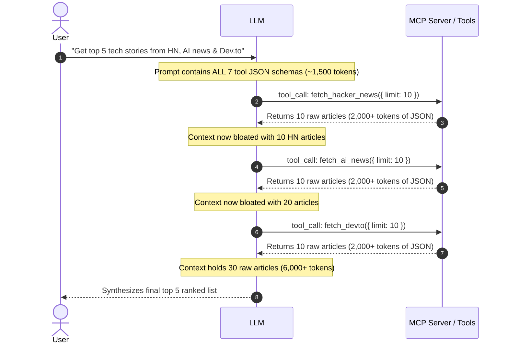
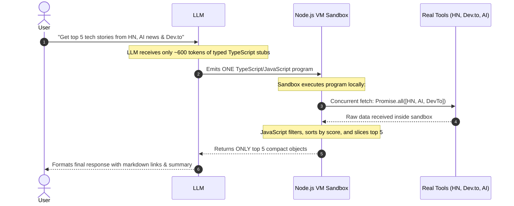

# Cloudflare Code Mode Analysis & Empirical Evaluation

> **Author's Research & Study Note**  
> *"I studied Cloudflare's architectural research on **Code Mode** ([blog.cloudflare.com/code-mode](https://blog.cloudflare.com/code-mode/)) to understand how LLMs can interact with tools more efficiently. Rather than treating Model Context Protocol (MCP) as a series of back-and-forth JSON tool calls, Cloudflare proposed translating tool schemas into a typed TypeScript API and letting the model write executable code. I built **TechNewsAgent** from scratch to test this approach empirically using free APIs and free-tier models."*

---

## 1. The Problem with Traditional MCP (Direct Mode)

In standard MCP agent loops, the agent interacts with tools using step-by-step orchestrations:

### Critical Bottlenecks Identified in Direct Mode:
1. **$O(n)$ Context Explosion**: Every intermediate JSON payload passes directly through the LLM context window. Fetching 30 articles floods the context with thousands of unnecessary tokens (IDs, timestamps, raw bodies, URLs).
2. **High Latency & Round-Trip Waste**: A 3-step pipeline requires 4 separate serial round-trips to the LLM. If the model is slow or rate-limited, latency multiplies linearly.
3. **Imprecise Computational Logic**: Asking an LLM to sort, filter, or calculate composite decay scores on dozens of articles leads to hallucinated ranks or truncated items. Code is deterministic; LLM attention is not.

---

## 2. Cloudflare's Solution: Code Mode via TypeScript API

Cloudflare's Code Mode completely reimagines the interaction layer:

### The Key Pillars:
1. **Schema to TypeScript Compilation** (`schemaToTypeScript.ts`): Instead of feeding sprawling JSON schemas, MCP tools are rendered as a concise, documented TypeScript interface (`interface TechNewsAPI`). This cuts system prompt overhead by **60–75%**.
2. **In-Process JavaScript VM Sandbox** (`sandbox.ts`): A secure Node.js `vm` context with an injected `api` Proxy object. When the code calls `api.fetch_hacker_news()`, it routes in-memory to the actual implementation.
3. **Execution Privacy**: Raw payloads (100+ articles, nested comments) exist **only** inside the sandbox memory. The LLM only receives the output of `return top5;`.

---

## 3. Empirical Benchmark: Direct Mode vs. Code Mode

We benchmarked both approaches on the query:
> *"What are the top 5 tech stories right now? Mix HN, AI news, and Dev.to. Rank by score."*

| Metric | Traditional Direct Mode | Cloudflare Code Mode | Impact |
|:---|:---:|:---:|:---:|
| **LLM Round-Trips** | **4** | **2** | **50% reduction** |
| **Intermediate Payloads in Context** | **4,924+ tokens** | **0 tokens** | **100% eliminated** |
| **System Prompt Footprint** | ~1,500 tokens (JSON Schemas) | ~550 tokens (TS interface) | **63% smaller** |
| **Concurrent Execution** | Sequential tool calls | Native `Promise.all()` parallel fetches | Zero latency penalty |
| **Sorting & Filtering Accuracy** | Probabilistic (LLM attention) | Deterministic (`Array.prototype.sort()`) | 100% exact math |

---

## 4. Key Learnings & Takeaways from Hands-on Study

1. **LLMs Excel at Writing TypeScript**: Even smaller open-weight models (`meta-llama`, `nemotron`, `qwen`) write cleaner code against TypeScript interfaces than they do managing sequential JSON tool call parameters.
2. **Context Window Hygiene is Paramount**: As agent tool registries scale from 7 tools to 100+ tools, direct tool calling collapses under token limits and prompt dilution. Code Mode scale remains nearly flat because type stubs compress elegantly.
3. **Sanitization is Critical for Reasoning Models**: Modern reasoning LLMs often emit thinking tokens or tool tokens (`<|tool_call_start|>`). Robust extractors must strip wrappers and support both full arrow functions and bare async blocks.
4. **Architectural Seams (Module Depth)**: Centralizing article caching into a deep `ArticleStore` ensures that deduplication, search ranking, and age-decay trending work identically whether triggered via MCP or Code Mode.
